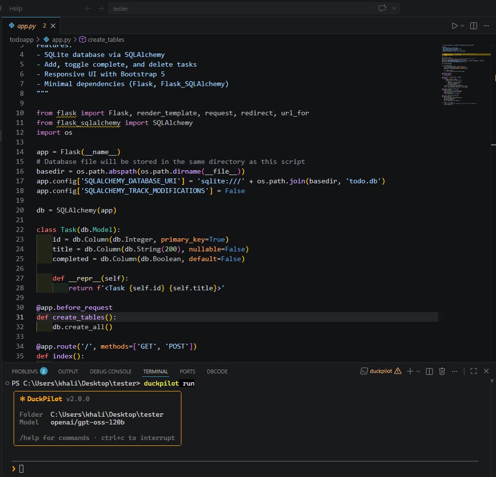

# 🦆 DuckPilot

**DuckPilot is an AI coding agent that lives in your terminal.**

You describe what you want in plain language, and it does the work: it reads your files, writes new ones, edits existing code, and runs commands to check that everything works.

DuckPilot is powered by [Groq](https://groq.com), providing fast AI responses.

```text
❯ create a todo app in Python with a tkinter GUI, save tasks to tasks.json

● Write(todo_app/main.py)
  ⎿  Wrote 142 lines to todo_app/main.py
     + import tkinter as tk
     + ...

● Run(python -m py_compile todo_app/main.py)
  ⎿  (no output)

● Done. I created todo_app/main.py. Run it with: python todo_app/main.py
```

---

## Quick start

### 1. Save your Groq API key

Get an API key from [Groq Console](https://console.groq.com/keys), then run:

```bash
duckpilot -key gsk_your_api_key
```

Your key is stored in `~/.duckpilot/config.json`.

**Keep your API key private.** Never share it or commit it to a public repository.

### 2. Go to your project folder and start DuckPilot

```bash
cd my-project
duckpilot run
```

### 3. Tell DuckPilot what you want

```text
❯ add a README to this project
```

That's it. DuckPilot works inside the folder where you started it.

---

## Commands

| Command | What it does |
|---|---|
| `duckpilot run` | Start the interactive agent in the current folder |
| `duckpilot run "<task>"` | Run one task and exit |
| `duckpilot -key <api-key>` | Save your Groq API key |
| `duckpilot --version` | Show the installed version |
| `duckpilot --help` | Show help |

### One-shot mode

Give DuckPilot a task directly without manually entering the interactive prompt:

```bash
duckpilot run "add type hints to utils.py"
duckpilot run "find and fix the bug in login.js, then run the tests"
```

---

## Using interactive mode

After running `duckpilot run`, you'll see a welcome box showing the version, working folder, and current model.

Type your request at the `❯` prompt and press Enter.

### What happens during a task?

DuckPilot follows an agent loop: it sends a request to the model, calls tools when needed, examines their results, and continues until the task is finished or the step limit is reached.

| You see | Meaning |
|---|---|
| `● Read(file)` | Reads a file |
| `● Write(file)` | Creates or overwrites a file |
| `● Update(file)` | Edits part of a file |
| `● List(folder)` | Lists a directory |
| `● Run(command)` | Runs a command after the required permission checks |
| `● search_files(...)` | Searches files for matching content |
| `● web_search(...)` | Searches the web |
| `● parse_json(...)` | Validates or parses JSON input |
| `✻ Worked for 12s · 5 tool calls` | Shows a summary when the task finishes |

The exact tools available depend on the installed version and its tool definitions.

### Slash commands

Type these at the prompt:

| Command | What it does |
|---|---|
| `/help` | Show available commands |
| `/clear` | Clear the conversation and start fresh |
| `/model` | Show the current model |
| `/model <name>` | Switch models for the current session |
| `/exit` | Exit DuckPilot (`exit` and `quit` also work) |

### Keyboard shortcuts

| Key | What it does |
|---|---|
| `Enter` | Send your message |
| `Ctrl+C` | Stop the running task |
| `Ctrl+C` twice at the prompt | Exit DuckPilot |

You can paste multi-line prompts. They are collected into a single message.

DuckPilot remembers the conversation while the program is running, allowing follow-up requests:

```text
❯ create hello.py that prints a greeting
❯ now make it ask for the user's name first
```

---

## Working folder

DuckPilot works in **the folder you were in when you started it**, regardless of where DuckPilot itself is installed.

For example, on Windows:

```powershell
cd D:\Projects\site-a
duckpilot run

cd D:\Projects\site-b
duckpilot run
```

The welcome box displays the current working directory under `Folder`.

### Using another location

You can request another location explicitly:

```text
❯ create a Flask app in D:\Projects\api
❯ save the notes on my Desktop
```

You can also use `~` to refer to your home directory.

Reading, writing, or listing paths outside the working folder requires permission.

---

## Permissions and safety

DuckPilot can modify files and run commands, so it uses permission checks for potentially risky operations.


### Access outside the working folder

Reading, writing, or listing a path outside the working folder requires permission.

Depending on the operation, choosing the persistent approval option allows the applicable access for the rest of the session.

### Files inside the working folder

Files inside the working folder can be created and edited directly, subject to the tool's behavior and applicable safety checks.

Review changes carefully. Use Git to track changes and recover from mistakes.

### Protected settings

DuckPilot restricts access to its own settings directory, `~/.duckpilot`, because it may contain your API key.

### Good habits

- Start DuckPilot inside your project folder.
- Read commands before approving them.
- Commit your work with Git before large tasks.
- Keep backups of important files.
- Never expose API keys in prompts, logs, or public repositories.

---

## Tools and testing

DuckPilot uses tools to interact with files, execute commands, and retrieve information.

Depending on the installed version, these tools may include:

- **File tools:** read files, write files, edit files, and list directories.
- **Command tool:** execute terminal commands.
- **Search tool:** search project files.
- **Web search tool:** search for information online.
- **JSON tool:** parse or validate JSON.

### Testing the tools

You can ask DuckPilot to test its own available tools without modifying the project.

Example prompt:

```text
Test every tool available to you through your actual tool-calling interface.

Do not edit, create, or delete project files.
Use safe arguments.
Test each tool once where possible.
Record the actual result or error for every tool.
Do not repeat successful calls or get stuck retrying failed calls.

At the end, report the total number of tools discovered,
passed, failed, and skipped.
Do not invent results.
```

For a complete test, make sure the agent tests the actual tools available through its tool-calling interface rather than merely inspecting their source definitions.

Some tools, such as file-writing and file-editing tools, need a safe test environment if you want to test them without changing project files.

---

## Writing good requests

DuckPilot works best with clear, specific instructions.

| Instead of | Try |
|---|---|
| `make a website` | `create a portfolio website with index.html, style.css and script.js; dark theme; a contact form` |
| `fix it` | `login.py crashes when the password is empty. Find the cause and fix it, then run it to check.` |
| `improve my code` | `refactor utils.py into smaller functions, preserve behavior, and run the tests` |

### Tips

- **Explain how to verify the result.** Ask DuckPilot to run tests or check syntax.
- **Name the files you want changed.** Include the folder when it matters.
- **Split large tasks into steps.** Smaller tasks are easier to verify.
- **Avoid commands that run indefinitely.** Build the application first, then start servers or GUI applications yourself.
- **Give feedback when something is wrong.** For example: `The Delete key doesn't work. Find the cause and fix it.`

### Example requests

```text
list the files here and explain what this project does
create a Python script that renames all .jpeg files in a folder to .jpg
read server.js and add error handling to every route
write unit tests for calculator.py and run them
create a .gitignore for a Node.js project
test all available tools without modifying any files
```

---

## Changing the model

The default model is:

```text
openai/gpt-oss-120b
```

Switch models for the current session:

```text
❯ /model llama-3.3-70b-versatile
```

You can also configure the model in `~/.duckpilot/config.json`:

```json
{
  "apiKey": "gsk_...",
  "model": "openai/gpt-oss-120b"
}
```

Available models can change over time. Check the [Groq model documentation](https://console.groq.com/docs/models) for current availability.

A model switch may help when a model is unavailable or its rate limits are restrictive. The alternative model must be supported by your configured provider.

---

## Rate limits and automatic retries

Groq API requests are subject to rate limits. These limits may include requests per minute, tokens per minute, and other model-specific restrictions.

DuckPilot can retry certain rate-limit errors with a delay that increases between attempts, depending on the current implementation.

This can help recover from temporary limits, but it **does not remove or bypass Groq's API limits**.

If you encounter repeated `429 Rate Limit` errors:

- Wait for the provider's rate-limit window to reset.
- Reduce the size of your prompts and the amount of conversation history sent to the model.
- Ask DuckPilot to perform large tasks in smaller steps.
- Avoid unnecessary tool calls and repeated file reads.
- Switch to another supported model if appropriate.
- Check your account's current limits in the [Groq Console](https://console.groq.com/).

Automatic retries can reduce interruptions caused by temporary limits, but repeated retries cannot guarantee success if the account or model remains rate-limited.

---

## Limits to know about

- Each request is limited to a maximum number of agent steps.
- Commands have a timeout.
- Long file contents and command output may be shortened before being sent to the model.
- Conversation history is kept only while the program is running.
- The model can make mistakes. Review important changes.
- API usage is subject to your provider's limits and account configuration.

The exact step limit, timeout, and retry settings depend on the installed version and its configuration.

---

## Troubleshooting

| Problem | What to do |
|---|---|
| `No API key found` | Run `duckpilot -key <your-key>` |
| `Your API key looks invalid` (`401`) | Check the key, create a new one if needed, and save it with `duckpilot -key` |
| `Rate limit reached` (`429`) | Wait for the limit to reset, reduce prompt size, or switch to another supported model |
| Repeated `429` errors | Check Groq's current rate limits. Automatic retries cannot remove provider limits |
| A reply is cut off | Ask DuckPilot to continue in smaller steps |
| It works in the wrong folder | Check the `Folder` line in the welcome box and start DuckPilot from the correct directory |

### Terminal color settings

DuckPilot respects `NO_COLOR` and supports `FORCE_COLOR=1`.

In PowerShell, force colors for the current terminal session with:

```powershell
$env:FORCE_COLOR="1"
node bin/duckpilot.js run
```

To disable colors for the current session:

```powershell
$env:NO_COLOR="1"
node bin/duckpilot.js run
```

Remove the environment variable or open a new terminal session to return to the default behavior.

---

## License

Copyright 2026 Amr Mohamed Hasanain.

Licensed under the [Apache License 2.0](LICENSE).
